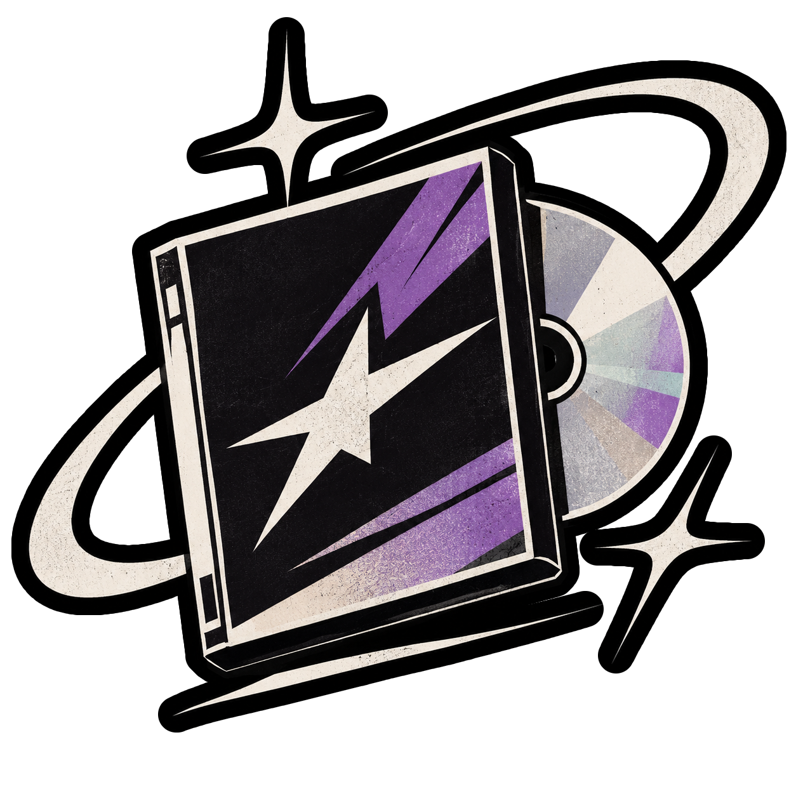
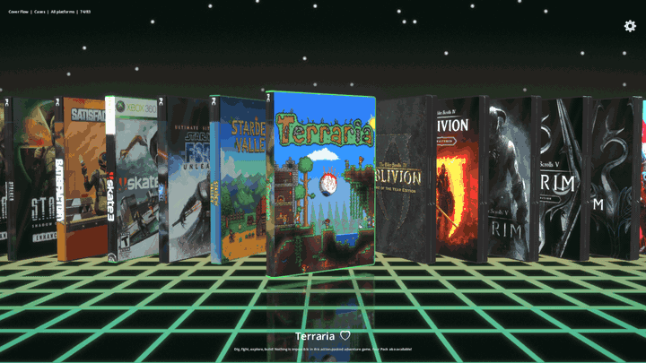
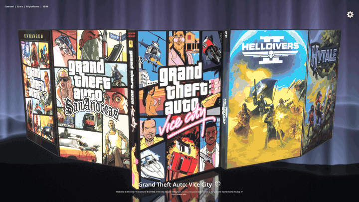
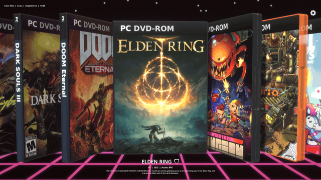
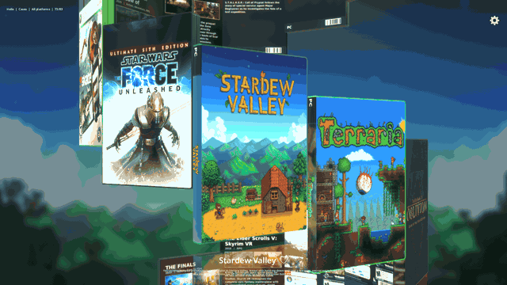
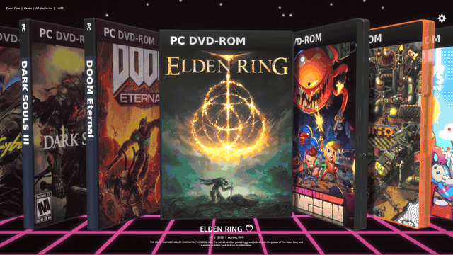
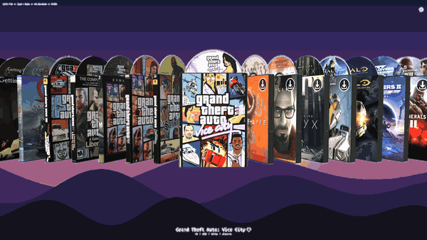
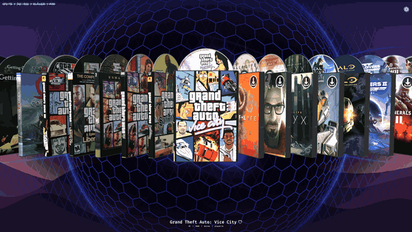

<div align="center">



# Slipcase

### Your game library, back on the shelf.

**A native 3D game launcher that turns every game you own into a real case, disc or cartridge.**<br>
Flick through them like the old console dashboards, crack one open, and play.

<sub><b>WARNING: VIBE CODED</b> (i just think its cool dont judge me)</sub>

<br>

[](https://github.com/kyagloski/slipcase/releases/latest)
[](https://github.com/kyagloski/slipcase/stargazers)


<br>


<br>



<br>

**[Download](https://github.com/kyagloski/slipcase/releases/latest)** &nbsp;•&nbsp;
**[Features](#-what-it-does)** &nbsp;•&nbsp;
**[Getting started](#-getting-started)** &nbsp;•&nbsp;
**[The guide](docs/GUIDE.md)**

</div>

---

Game launchers are spreadsheets. Rows of rectangles, a search box, a Play button. My Steam library has
200+ games in it and none of them felt like *things*.

**Slipcase** is one native binary (no Electron, no web view) that renders your whole collection in 3D:
real DVD cases, jewel cases, cardboard boxes and carts, with box art it finds on its own. Spin them, open
them, pile them up, throw them around, then hit Enter and it gets out of the way.

## ✨ What it does

<table>
<tr>
<td width="50%" valign="top">

### 📀 Real cases, not thumbnails
DVD keep cases, PS1 jewel cases, NES and N64 cardboard boxes, DS and Game Boy carts. Every platform gets
the right size, shape, plastic and console banner, and discs shimmer like actual discs.

</td>
<td width="50%" valign="top">

### 📖 Crack them open
Press Space and the case swings open: the disc sits on its hub and the insert is a booklet you can page
through, with the description, screenshots and how many people are playing right now.

</td>
</tr>
</table>

<div align="center">

</div>

### 🗂️ Fourteen ways to browse

Cover Flow, a carousel, a bookshelf, towers of stacked cases, a helix, a wall, a table you look down on,
rows of spines and more. **Tab** flips between them, and the list can loop forever.

<div align="center">

</div>

### 🌌 Backgrounds with attitude

A neon synthwave grid, a pixel-art landscape, a cosmic web, northern lights, the PS2 menu's orbs, the original Xbox's green
glow, blurred game art, or a picture or GIF of your own. Let them pick up the colours of whatever game
you're on, or set your own palette with the colour picker.

<div align="center">

</div>

### 🎲 Can't decide what to play?

Tap **Ctrl five times**. Your whole library rains onto a table, piles up with real physics, and one game
climbs out of the pile for you.

<div align="center">

</div>

### 🪟 Float over your desktop

Turn on overlay and the window disappears: no border and no background, just your games floating over
whatever's on screen. Halfway mode keeps the background in the middle and fades it out into your
desktop. Either way it gets out of the way the moment a game launches.

<table>
<tr>
<td width="50%"></td>
<td width="50%"></td>
</tr>
<tr>
<td align="center"><sub>Overlay: just the games</sub></td>
<td align="center"><sub>Halfway: the background fades into your desktop</sub></td>
</tr>
</table>

## 🕹️ Everything else

- **🔍 Finds your games**: Steam, Epic, GOG, EA, Ubisoft, Heroic, Lutris and Flatpak, plus ROM folders and anything you drag onto the window. It works out the console from the file itself.
- **🖼️ Art from everywhere**: SteamGridDB, Steam, LaunchBox, libretro and more, picked automatically. Or open the art picker and choose the cover, back, spine, disc and insert yourself.
- **✋ Feels good to touch**: covers lean away from the mouse, drag a case to spin it, flick to send it spinning, scroll with momentum. **Ctrl + drag** picks a game up and lets you throw it into the others. Gamepads work too.
- **🎨 Make it yours**: per-game case colours (see-through too), highlight colours, background palettes, motion styles, case corners, sizes, field of view, a shine across the selected game, a mirror reflection under it, glossy print, the shelf colour, retro screen filters (CRT, VHS, Game Boy, 8-bit, film grain and more) and the interface font (Minecraft-style pixels included). Every setting is in the menu and nothing needs a config file.
- **🍷 Windows games on Linux**: programs and installers run through Proton, with a per-game Proton build and options.
- **📦 Owned but not installed?** Optional. They show up with a download badge, and Enter opens the store's install dialog.
- **⚡ Fast**: one Rust binary on Bevy, with every cover, spine and disc cached after the first run.

<div align="center">

**Plays nice with:** PC • NES • SNES • N64 • GameCube • Wii • Switch • Switch 2 • Game Boy / Color / Advance • DS • 3DS<br>
PlayStation 1–5 • PSP • Vita • Xbox • Xbox 360 • Xbox One • Genesis • Saturn • Dreamcast

</div>

## 🚀 Getting started

<div align="center">

[](https://github.com/kyagloski/slipcase/releases/latest)

<sub>Linux AppImage, Windows .exe and macOS builds, for x86_64 and ARM64.</sub>

</div>

Or build it yourself:

```sh
git clone https://github.com/kyagloski/slipcase && cd slipcase
./build.sh                       # Linux   -> dist/slipcase-linux-x86_64
./dist/slipcase-linux-x86_64
```

On Windows run `.\build.ps1` instead, which gives you `dist\slipcase-windows-x86_64.exe`.

The first launch scans your stores and grabs covers in the background. After that it opens straight to
where you left off.

| Key | |
|---|---|
| **← →** | browse |
| **Enter** | play |
| **Space** | open the case |
| **Tab** | next layout |
| **B** | next background |
| **Right-drag** / **drag the selected game** | spin it |
| **Ctrl + drag** | pick a game up and throw it |
| **M** / **F1** | settings |

Everything is rebindable. For every option, layout, key and config value, see **[the guide](docs/GUIDE.md)**.

## 🙏 Thanks

Box art and game details come from [SteamGridDB](https://www.steamgriddb.com),
[LaunchBox Games Database](https://gamesdb.launchbox-app.com), Steam and
[libretro-thumbnails](https://github.com/libretro-thumbnails/libretro-thumbnails). The PS2 background
follows the lovely recreation at [imsaud.me](https://www.imsaud.me), and the settings icons are
[Twemoji](https://github.com/jdecked/twemoji) (CC-BY 4.0). The bundled fonts are
[Monocraft](https://github.com/IdreesInc/Monocraft), Press Start 2P, VT323, Silkscreen, Orbitron, Audiowide
and Bungee, all under the SIL Open Font License. Built with [Bevy](https://bevyengine.org)
and [Rapier](https://rapier.rs).

<div align="center">

<br>

**If Slipcase made your library feel like a shelf again, a ⭐ helps other people find it.**

<sub>Made because launchers should feel like opening a game, not a spreadsheet.</sub>

</div>
