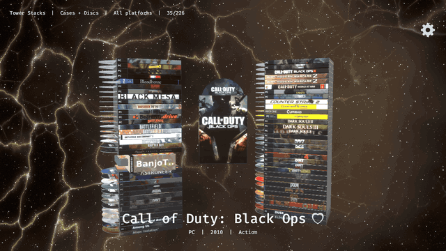
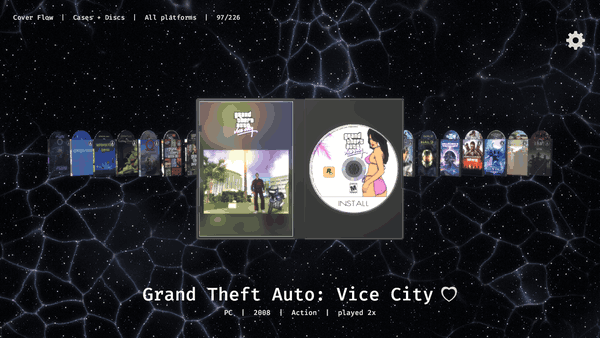
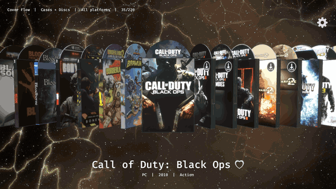
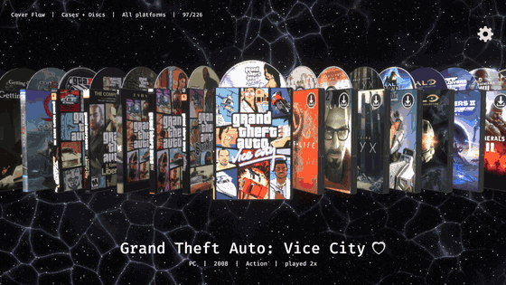
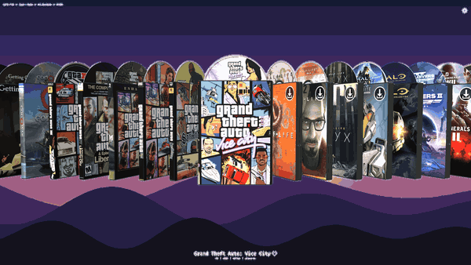
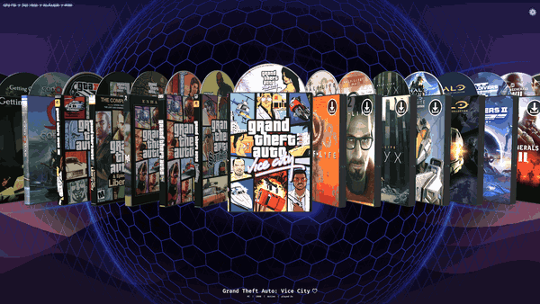
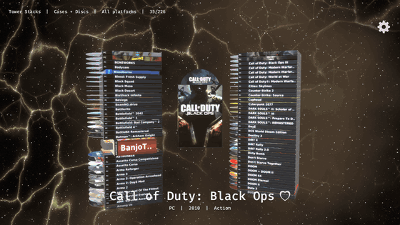

<div align="center">


# Slipcase

**Your game library, back on the shelf.**

A native 3D game launcher that shows every game you own as a real case, disc or cartridge,<br>
like the old console dashboards. Pull one off the pile, open it up, read the manual, play.


M / ⚙️ 	settings


</div>

---

I got tired of game launchers that are just a grid of rectangles. My Steam library has 200+ games in it
and none of them felt like *things*. Slipcase fixes that: it's one native binary (no Electron, no web
view) that renders your whole collection in 3D, finds the box art on its own, and gets out of the way the
moment you hit Enter.

## ✨ What it does

<table>
<tr>
<td width="50%">

### Real cases, not thumbnails
DVD keep cases, PS1 jewel cases, NES and N64 cardboard boxes, DS and Switch carts. Each platform gets
the right size, shape, plastic colour and banner. Discs shimmer like actual discs.

</td>
<td width="50%">

### Open them up
Press Space and the case swings open. The disc spins on its hub, and the insert is a booklet you can
page through: description, credits, screenshots, even how many people are playing right now.

</td>
</tr>
</table>

<div align="center">

</div>

### 🗂️ Fourteen ways to browse

Cover Flow, a bookshelf, towers of stacked cases, a carousel, a table, a wall, a row of spines and more.
Tab flips between them, and the list can loop forever if you never want to hit the end.

<div align="center">

</div>

### 🌌 Backgrounds that match the game

Animated backgrounds take their colours from whatever game you're on. There's a cosmic web, a neon
synthwave grid, northern lights, the PS2 menu's orbs, the original Xbox's green glow, blurred game art,
or a picture or GIF of your own.

<div align="center">

</div>

### 🪟 Passthrough mode

Turn on overlay and the window disappears. No border and no background, just your games floating
over whatever's on screen. Halfway mode keeps the background in the middle and lets it fade out into
your desktop. Either way it gets out of the way the moment a game launches.

<table>
<tr>
<td width="50%"></td>
<td width="50%"></td>
</tr>
<tr>
<td align="center"><sub>Overlay: just the games</sub></td>
<td align="center"><sub>Halfway: the background fades into your desktop</sub></td>
</tr>
</table>

### 🎲 Can't decide what to play?

Tap **Ctrl five times**. Every game you own rains onto a table, piles up with real physics (you can grab
and throw them), and one climbs out of the pile for you.

<div align="center">

</div>

## 🕹️ Everything else

- **Finds your games**: Steam, Epic, Heroic and Lutris, plus ROM folders and anything you drag onto the window. It works out the console from the file itself.
- **Owned but not installed?** Optional. They show up with a little download badge, and Enter opens the store's install dialog.
- **Art from everywhere**: SteamGridDB, Steam, LaunchBox, libretro and more, picked automatically. Or open the art picker and choose the cover, back, spine, disc and insert yourself.
- **Feels good to touch**: covers lean away from the mouse like the Steam library, flick to spin a case, drag with momentum, and a gamepad works too.
- **Fast**: one Rust binary on Bevy, with every cover, spine and disc cached after the first run.

## 🚀 Getting started

```sh
git clone https://github.com/kyagloski/slipcase && cd slipcase
./build.sh                       # Linux   -> dist/slipcase-linux-x86_64
./dist/slipcase-linux-x86_64
```

On Windows run `.\build.ps1` instead, which gives you `dist\slipcase-windows-x86_64.exe`.

The first launch scans your stores and starts grabbing covers in the background. After that it opens
straight to where you left off.

| | |
|---|---|
| **← →** | browse |
| **Enter** | play |
| **Space** / **Shift** | open the case |
| **Tab** | next layout |
| **B** | next background |
| **M** / **F1** | settings |

Everything is rebindable, and every setting has a menu entry. For the full list of options, layouts,
keys and config values, see **[the guide](docs/GUIDE.md)**.

## 🙏 Thanks

Box art and game details come from [SteamGridDB](https://www.steamgriddb.com),
[LaunchBox Games Database](https://gamesdb.launchbox-app.com), Steam and
[libretro-thumbnails](https://github.com/libretro-thumbnails/libretro-thumbnails). The PS2 background
follows the lovely recreation at [imsaud.me](https://www.imsaud.me), and the settings icons are
[Twemoji](https://github.com/jdecked/twemoji) (CC-BY 4.0). Built with [Bevy](https://bevyengine.org)
and [Rapier](https://rapier.rs).

<div align="center"><sub>Made because launchers should feel like opening a game, not a spreadsheet.</sub></div>
